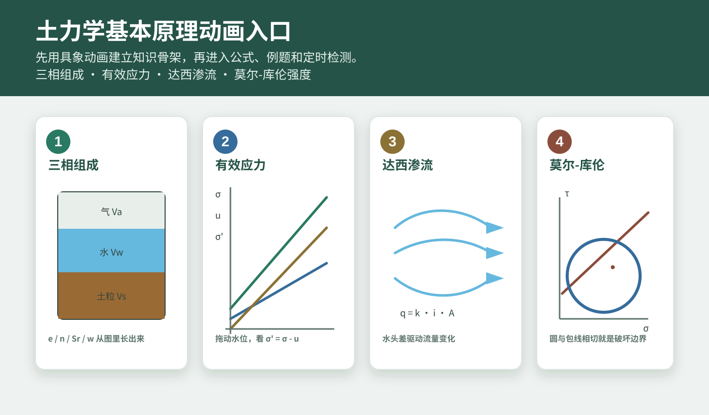
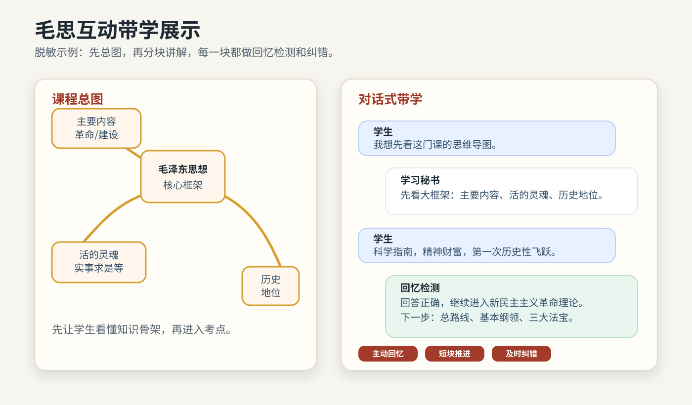
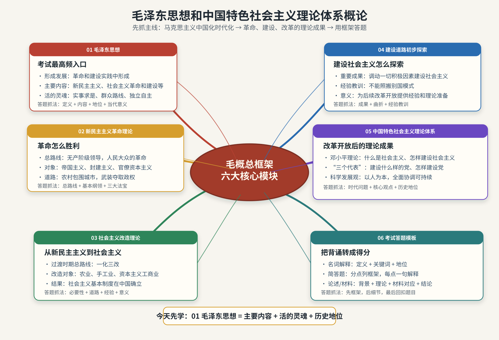

# Final Exam Study Coach

一个面向大学期末周的 Codex skill：把教材、笔记、课件、考试范围、往年题、剩余时间和学生当前水平，整理成可执行的提分计划，并在后续对话中像私人学习秘书一样带着学生复习、检测、复盘和调整。

## 为什么做这个

很多大学生到了期末周不是不想学，而是不知道先学什么、怎么判断重点、怎样把有限时间变成分数。普通复习计划常见的问题是：

- 只按章节排日程，不按提分收益排序。
- 只总结知识点，不带着学生做题和检测。
- 不考虑拖延，计划一旦落后就崩。
- 长对话或跨天学习后容易忘记进度。
- 文科、理工科都用同一种复习方式，效果粗糙。

Final Exam Study Coach 的目标是把这些问题做成一套稳定工作流。

## 核心能力

- **材料整理**：读取教材、笔记、PPT、考试范围、往年题、作业和用户口述，建立材料清单和主题索引。
- **课程建模**：先回答“这门课到底研究什么、考试真正考什么能力”，再拆成知识单元、考试操作和评分点。
- **提分计划**：按边际提分收益排序，而不是照章节机械推进。
- **拖延缓冲**：默认学生会拖延，例如 8 天任务按 6 天排完，后面留给缓冲、错题和回炉。
- **动态修正**：学生偷懒、没做完或做错时，立即砍低收益内容，保高证据高分内容。
- **带学模式**：讲解、主动回忆、短测、例题复现、限时练习、错题归因和讲给别人听。
- **先导动画判断**：只有理工科这类有具象动态原理的课程才先放动画；文科课程继续使用主线图、时间线、对比表、论述模板和检索练习。
- **定时复习检测**：10 分钟、当天、第二天、3-7 天安排复测，避免“看懂错觉”。
- **上下文恢复**：跨天、长任务或上下文压缩后，先读检查点继续，不靠聊天记忆硬撑。

## 展示栏

### 土力学具象原理动画



这个示例展示了 skill 对理工科课程的处理方式：先判断是否存在具象动态原理，再用动画建立知识骨架，最后接公式、例题和定时检测。示例入口在 `examples/soil-mechanics-animations/index.html`。

### 毛思课程总图与互动带学





这个示例展示了 skill 对文科/思政课程的处理方式：不强行动画化，而是使用总图、主线、概念框架、主动回忆和短块检测推进学习。互动展示图为脱敏公开示例。

## 适用场景

- 期末周多门课同时复习。
- 距离考试只剩 1-7 天，需要快速保分提分。
- 有大量 PDF/PPT/笔记/试卷但不知道怎么整理。
- 想让 AI 不只是列计划，而是每天带着学、检查、重排。
- 想给一门课建立长期学习系统，而不是临时抱佛脚。

## 仓库结构

```text
final-exam-study-coach/
  SKILL.md
  agents/openai.yaml
  references/
  scripts/
examples/
  soil-mechanics-animations/
docs/
  product-introduction.md
  release-post.md
  release-notes-v0.1.0.md
```

`final-exam-study-coach/` 是可安装的 skill 文件夹。`examples/` 只放自生成演示，不包含用户私有教材、课件或试卷。

## 安装方式

把 `final-exam-study-coach` 文件夹复制到 Codex skills 目录：

```powershell
Copy-Item -Recurse .\final-exam-study-coach "$env:USERPROFILE\.codex\skills\final-exam-study-coach"
```

然后在 Codex 中使用：

```text
Use $final-exam-study-coach 帮我根据这门课的课件、考试范围和剩余时间制定期末提分计划，并从第一个学习块开始带我复习。
```

## 示例：土力学先导动画

土力学属于有具象动态原理的工程课，因此 skill 会先给基本原理动画入口，再进入题型训练。

本仓库包含一个自生成示例：

- `examples/soil-mechanics-animations/index.html`
- 三相组成与指标换算
- 有效应力原理
- 达西定律与渗流
- 莫尔-库伦强度理论

这些示例用于展示“先建立知识骨架，再做题检测”的教学方式。

## 隐私说明

这个发布包刻意不包含任何个人教材、课程 PDF、PPT、试卷、学习记录或考试安排截图。实际使用时，用户材料应留在本地工作区，由 Codex 在当前会话中读取和处理。

## 当前版本

v0.1.0：期末复习私人学习秘书初版，包含材料整理、课程建模、提分计划、拖延缓冲、带学复盘、定时检测、上下文恢复和理工科具象原理动画判断。

## Token 成本透明

本项目的生成过程记录了 goal 级别 token 用量。动画相关工作没有逐文件精确计量，但有透明估算，见 `docs/token-cost-report.md`。
