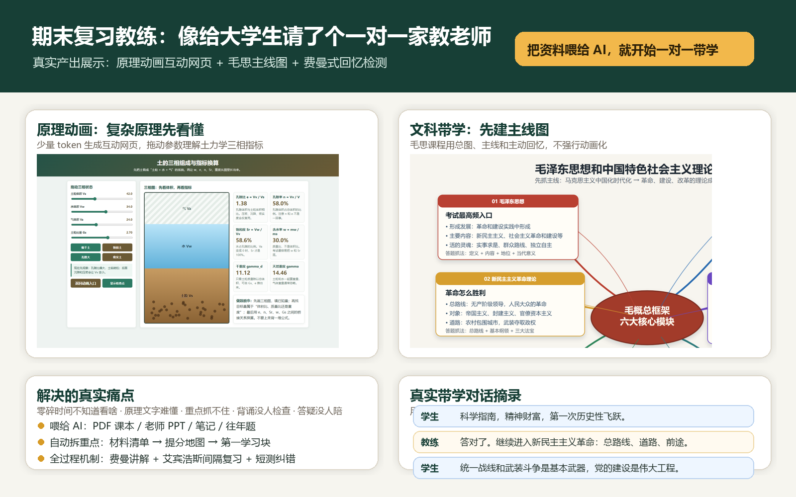

# Final Exam Study Coach

一个面向大学期末周的 Codex skill：把 PDF 课本、老师 PPT、笔记、考试范围、往年题和碎片化可用时间，变成“今天该看什么、怎么理解、怎么背、怎么测”的一对一复习陪跑。

## 为什么做这个

很多大学生到了期末周不是不想学，而是卡在这些很具体的问题上：

- 零碎时间里不知道该看哪一章、哪张 PPT、哪道题。
- 知识点原理太复杂，只靠文字很难看懂。
- 内容太多，抓不住真正高收益重点。
- 背诵没人辅助检查，以为会了其实说不出来。
- 做题和复述时没人即时答疑、纠错、继续推进。
- 普通计划只排日程，不会根据拖延和掌握情况动态重排。

Final Exam Study Coach 的目标是：像给自己请了个一对一家教老师。你把能覆盖知识点的资料喂给 AI，它负责拆重点、讲原理、做检测、盯进度、答疑和重排。

## 核心能力

- **材料整理**：读取教材、笔记、PPT、考试范围、往年题、作业和用户口述，建立材料清单和主题索引。
- **课程建模**：先回答“这门课到底研究什么、考试真正考什么能力”，再拆成知识单元、考试操作和评分点。
- **提分计划**：按边际提分收益排序，而不是照章节机械推进。
- **原理动画**：对土力学、工程、数学、物理等有具象原理的课程，用较少 token 快速生成对应原理互动网页，先看懂基本原理再做题。
- **拖延缓冲**：默认学生会拖延，例如 8 天任务按 6 天排完，后面留给缓冲、错题和回炉。
- **动态修正**：学生偷懒、没做完或做错时，立即砍低收益内容，保高证据高分内容。
- **科学带学**：参考费曼学习法和艾宾浩斯遗忘曲线，用讲解、主动回忆、短测、例题复现、限时练习、错题归因和间隔复习贯穿全过程。
- **先导动画判断**：只有理工科这类有具象动态原理的课程才先放动画；文科课程继续使用主线图、时间线、对比表、论述模板和检索练习。
- **定时复习检测**：10 分钟、当天、第二天、3-7 天安排复测，避免“看懂错觉”。
- **上下文恢复**：跨天、长任务或上下文压缩后，先读检查点继续，不靠聊天记忆硬撑。

## 展示栏



这张图使用的是本项目真实生成产物：土力学三相组成互动动画页、毛思清晰思维导图，以及复习过程中真实带学对话摘录。

### 原理动画：复杂原理先看懂

理工科很多知识不是“背一句定义”就能懂。比如土力学的三相组成、有效应力、达西渗流、莫尔-库伦强度，做成互动网页后，学生可以拖动参数，看指标怎么变，再接公式和例题。

示例入口：`examples/soil-mechanics-animations/index.html`

### 文科带学：主线图 + 背诵检查

毛思、史纲这类课程不会强行动画化，而是先做主线图和概念框架，再用主动回忆检查背诵。用户回答后，skill 会判断是否答到点上，纠错后继续推进下一块。

## 适用场景

- 期末周多门课同时复习。
- 距离考试只剩 1-7 天，需要快速保分提分。
- 有大量 PDF 课本、老师 PPT、笔记、试卷，但不知道怎么整理。
- 想让 AI 不只是列计划，而是每天带着学、检查、重排。
- 想给一门课建立长期学习系统，而不是临时抱佛脚。

## 仓库结构

```text
final-exam-study-coach/
  SKILL.md
  agents/openai.yaml
  references/
  scripts/
examples/
  soil-mechanics-animations/
docs/
  product-introduction.md
  release-post.md
  release-notes-v0.1.0.md
```

`final-exam-study-coach/` 是可安装的 skill 文件夹。`examples/` 只放自生成演示，不包含用户私有教材、课件或试卷。

## 安装方式

把 `final-exam-study-coach` 文件夹复制到 Codex skills 目录：

```powershell
Copy-Item -Recurse .\final-exam-study-coach "$env:USERPROFILE\.codex\skills\final-exam-study-coach"
```

然后在 Codex 中使用：

```text
Use $final-exam-study-coach 我把这门课的 PDF 课本、老师 PPT、考试范围和往年题放进工作区了，帮我制定期末提分计划，并从第一个学习块开始像一对一家教一样带我复习。
```

使用方法很简单：把任何能包含全部知识点的资料给到 AI，包括但不限于 PDF 版课本、老师的 PPT、课堂笔记、考试范围、往年题和错题记录。

## 示例：土力学先导动画

土力学属于有具象动态原理的工程课，因此 skill 会先给基本原理动画入口，再进入题型训练。

本仓库包含一个自生成示例：

- `examples/soil-mechanics-animations/index.html`
- 三相组成与指标换算
- 有效应力原理
- 达西定律与渗流
- 莫尔-库伦强度理论

这些示例用于展示“先建立知识骨架，再做题检测”的教学方式。

## 隐私说明

这个发布包刻意不包含任何个人教材、课程 PDF、PPT、试卷、学习记录或考试安排截图。实际使用时，用户材料应留在本地工作区，由 Codex 在当前会话中读取和处理。

## 当前版本

v0.1.0：期末复习私人学习秘书初版，包含材料整理、课程建模、提分计划、拖延缓冲、带学复盘、定时检测、上下文恢复和理工科具象原理动画判断。

## Token 成本透明

本项目的生成过程记录了 goal 级别 token 用量。动画相关工作没有逐文件精确计量，但有透明估算，见 `docs/token-cost-report.md`。
